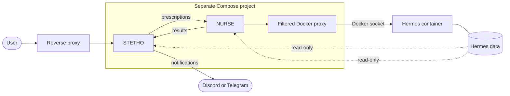

# Architecture

> Target architecture. Only the loading of the STETHO settings and translations is
> implemented.

## Goal

Show at a glance whether Hermes Agent works, send an alert when it breaks, and repair it with
predefined actions. Hermes itself is neither modified nor upgraded.

## Overview

## Components

| Component | Role | Exposure and rights |
| --- | --- | --- |
| STETHO | Reads, diagnoses, displays and alerts | Reached through the reverse proxy; no Docker access |
| NURSE | A monolith: checks prescriptions again, then runs the actions of its catalogue | No port; Docker through the proxy |
| Docker proxy | Allows a closed list of calls on the Hermes container | Internal network only |

## Data flows

1. STETHO reads the Hermes files periodically and applies the diagnosis rules.
2. The page shows the result. Incidents are sent to the notification channel.
3. A button, or an automatic rule, makes STETHO write a **prescription** (an action code and an
   optional target).
4. NURSE validates it from scratch: file, action, target format, target existence, relevance
   and rate limits.
5. NURSE runs the action, verifies its effect and writes a **result**, which STETHO reads.

A prescription is the only path from STETHO to an action.

## STETHO structure

Each monitored domain is a self-contained module that can be enabled or disabled.

| Part of a module | Responsibility |
| --- | --- |
| Reader and adapters | Turn Hermes files into neutral data. Only this part knows their format |
| Rules | Conditions, thresholds, status, message and suggested action, in YAML |
| Card | Presentation on the page |
| Tests | Sample files for each supported Hermes version |

The core handles scheduling, isolation, timeouts, anomalies, incidents and alerts. Adding a
domain means adding a module; supporting a new Hermes format means adding an adapter.

## NURSE structure

NURSE is a single program without modules. Its actions are declared in `actions.toml`, so adding
one needs no code unless it requires a new kind of check. See
[corrective actions](features/actions.md).

## Design principles

- A check that cannot be performed reports `unknown`, never `ok`.
- A failing sensor affects only its own card.
- Nothing specific to an installation is hard-coded.
- No LLM and no message content in the page or the alerts.

## Trust boundaries

The exposed service has no rights, and the privileged service is not exposed. NURSE never
trusts a prescription, never uses a shell and acts only on the configured container. See
[security](features/security.md) for the limits of this model.
